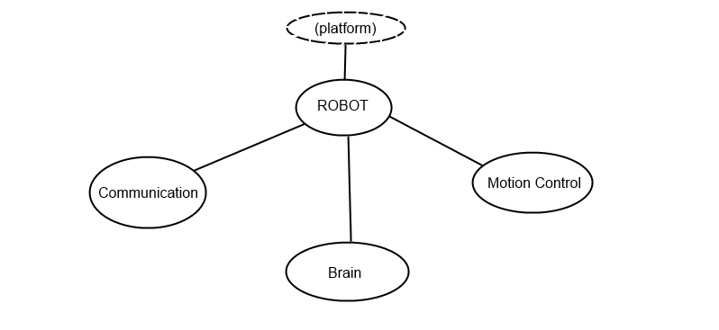
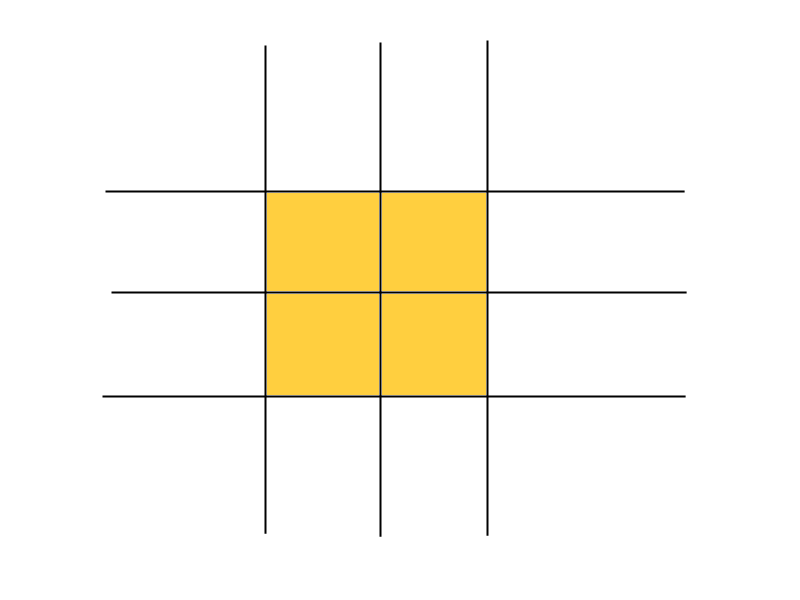

# {{ page.title }}

For my 2014 candidate thesis, I designed a reusable software structure for robot swarms. Each robot has a **Communication** component for exchanging messages, **Motion Control** for its hardware and positioning, and a mission-specific **Brain** that runs algorithms. The robot-specific parts can be replaced without rewriting the swarm behavior.

<figure>
  
  <figcaption>The reusable parts of each robot's software.</figcaption>
</figure>

## Intersection algorithm

The crossing is split into four sections. Before entering, a robot broadcasts which sections it needs and waits for replies. A robot already using a conflicting section, or holding a higher-priority request, can reply “no”; the requester then waits and tries again. Sequence numbers and robot IDs settle competing requests. With no negative reply, the robot enters and releases each section as it leaves it.

<figure>
  
  <figcaption>Each robot requests only the intersection sections its path uses.</figcaption>
</figure>

  <iframe src="https://www.youtube.com/embed/L4P7b22_g4o" title="Robot swarm intersection algorithm" loading="lazy" allow="accelerometer; autoplay; clipboard-write; encrypted-media; gyroscope; picture-in-picture; web-share" allowfullscreen></iframe>

## Planning

In the other demonstration, a coordinator assigns random destinations and keeps the robots from colliding on their way there. The algorithm issues general 2D movement commands, such as rotating and moving forward; each robot's Motion Control component translates them into its own hardware actions.

  <iframe src="https://www.youtube.com/embed/q9s1wcxgezs" title="Robot swarm planning" loading="lazy" allow="accelerometer; autoplay; clipboard-write; encrypted-media; gyroscope; picture-in-picture; web-share" allowfullscreen></iframe>

